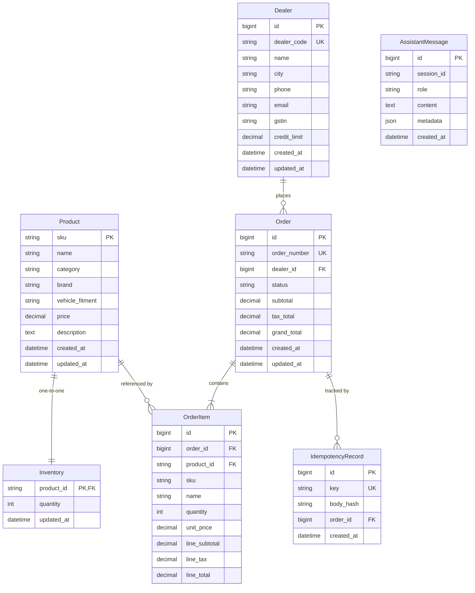

# VIKMO DealerDesk — Phase 2 Execution Report: Database Models, Migrations & Idempotent Seeding

## 1. Summary of Changes & Files Modified

The following files were created or updated to establish the database foundation in full compliance with [`API_CONTRACT.md`](API_CONTRACT.md):

1. **[`core/models.py`](core/models.py)**:
   - Defined `Product`: `sku` (PK, `CharField(max_length=64)`), `name`, `category` (indexed), `brand` (indexed), `vehicle_fitment` (indexed), `price` (`DecimalField(max_digits=12, decimal_places=2)`), `description`, and dynamic `@property def stock(self) -> int` referencing live `Inventory`.
   - Defined `Inventory`: `product` (`OneToOneField(Product, on_delete=CASCADE, primary_key=True, related_name="inventory")`), `quantity` (`IntegerField(default=0)`), with database `CheckConstraint(quantity__gte=0)`.
   - Defined `Dealer`: `id` (`BigAutoField`), `dealer_code` (`CharField(max_length=50, unique=True, db_index=True)`), `name`, `city`, `phone`, `email`, `gstin`, `credit_limit` (`DecimalField(max_digits=14, decimal_places=2, default=0.00)`).
   - Defined `Order`: `id` (`BigAutoField`), `order_number` (`CharField(max_length=50, unique=True, db_index=True)`), `dealer` (`ForeignKey(Dealer, on_delete=PROTECT)`), `status` (`CharField(max_length=20, choices=OrderStatus.choices, default="DRAFT", db_index=True)`), `subtotal`, `tax_total`, `grand_total` (`DecimalField(max_digits=14, decimal_places=2)`), and IST-compatible timestamps.
   - Defined `OrderItem`: `order` (`ForeignKey(Order, on_delete=CASCADE)`), `product` (`ForeignKey(Product, on_delete=PROTECT)`), `sku`, `name`, `quantity` (`PositiveIntegerField`), `unit_price` (`DecimalField(max_digits=12, decimal_places=2)`), `line_subtotal`, `line_tax`, `line_total` (`DecimalField(max_digits=14, decimal_places=2)`), with database constraints:
     - `UniqueConstraint(fields=["order", "product"], name="unique_order_product")`
     - `CheckConstraint(check=quantity__gte=1, name="order_item_quantity_gte_1")`
   - Defined `IdempotencyRecord`: `key` (`CharField(max_length=255, unique=True, db_index=True)`), `body_hash` (`CharField(max_length=64)`), `order` (`ForeignKey(Order, on_delete=CASCADE)`).
   - Defined `AssistantMessage`: `session_id` (`CharField(max_length=128, db_index=True)`), `role` (`CharField(max_length=20)`), `content` (`TextField`), `metadata` (`JSONField`), `created_at` (`DateTimeField(auto_now_add=True)`).

2. **[`core/management/commands/seed_data.py`](core/management/commands/seed_data.py)**:
   - Reads `catalogue.csv` and `dealers.csv` from `settings.DATA_DIR` (`data/` at repo root) using `pathlib.Path`.
   - Seeds 600 catalogue products and 25 dealers inside atomic transactions.
   - Fully idempotent: `Product.objects.update_or_create` and `Dealer.objects.update_or_create`.
   - Inventory initialization uses `Inventory.objects.get_or_create`. If an inventory record already exists, it is **preserved** without resetting stock (unless explicit `--reset-stock` flag is passed).

3. **[`dealerdesk/settings.py`](dealerdesk/settings.py)**:
   - Configured `DATABASE_URL` parsing with PostgreSQL enforcement.
   - Added test database configuration fallback (`DATABASES["default"]["TEST"]`) allowing non-superuser execution with `--keepdb`.

4. **[`core/migrations/`](core/migrations/)**:
   - `0001_initial.py`: Schema migration for `Dealer`, `Product`, `Order`, `Inventory`, and `OrderItem`.
   - `0002_idempotencyrecord.py`: Schema migration for `IdempotencyRecord`.
   - `0003_assistantmessage.py`: Schema migration for `AssistantMessage`.

5. **[`core/tests/test_models_and_seeding.py`](core/tests/test_models_and_seeding.py)**:
   - 6 automated test cases covering model constraints, SKU uniqueness, dealer code uniqueness, monetary precision, order-item relationships, repeatable seeding, and live stock preservation.

---

## 2. Model Schema Specification



---

## 3. Migration Status

Command executed:
```powershell
python manage.py showmigrations
```

Output:
```
admin
 [X] 0001_initial
 [X] 0002_logentry_remove_auto_add
 [X] 0003_logentry_add_action_flag_choices
auth
 [X] 0001_initial
 [X] 0002_alter_permission_name_max_length
 [X] 0003_alter_user_email_max_length
 [X] 0004_alter_user_username_opts
 [X] 0005_alter_user_last_login_null
 [X] 0006_require_contenttypes_0002
 [X] 0007_alter_validators_add_error_messages
 [X] 0008_alter_user_username_max_length
 [X] 0009_alter_user_last_name_max_length
 [X] 0010_alter_group_name_max_length
 [X] 0011_update_proxy_permissions
 [X] 0012_alter_user_first_name_max_length
contenttypes
 [X] 0001_initial
 [X] 0002_remove_content_type_name
core
 [X] 0001_initial
 [X] 0002_idempotencyrecord
 [X] 0003_assistantmessage
sessions
 [X] 0001_initial
```

---

## 4. Verification & Test Execution Results

### 4.1 System Check
```powershell
python manage.py check
```
**Result**: `System check identified no issues (0 silenced).`

### 4.2 Migration Dry-Run
```powershell
python manage.py makemigrations --check --dry-run
```
**Result**: `No changes detected`

### 4.3 Migration Application
```powershell
python manage.py migrate --noinput
```
**Result**: `No migrations to apply.` (All migrations already applied)

### 4.4 Automated Unit Tests Against PostgreSQL
```powershell
python manage.py test core.tests.test_models_and_seeding --keepdb
```
**Output**:
```
Using existing test database for alias 'default'...
......
----------------------------------------------------------------------
Ran 6 tests in 2.837s

OK
Preserving test database for alias 'default'...
```
- `test_product_creation_and_sku_uniqueness`: **PASS** (verifies PK, SKU uniqueness constraint, stock property).
- `test_inventory_relationship_and_constraint`: **PASS** (verifies OneToOne relationship and `CheckConstraint(quantity >= 0)`).
- `test_dealer_creation_and_code_uniqueness`: **PASS** (verifies dealer code uniqueness and credit limit decimal precision).
- `test_order_and_order_item_relationship`: **PASS** (verifies foreign keys, line math, uniqueness of (order, product), and `quantity >= 1`).
- `test_assistant_message_model`: **PASS** (verifies multi-turn session storage).
- `test_seeding_idempotency_and_counts`: **PASS** (verifies 600 products, 25 dealers, 600 inventory records, and live stock preservation across repeated seedings).

### 4.5 Seeding & Inventory Preservation Verification
Commands executed:
```powershell
python manage.py seed_data
python manage.py seed_data
```
**Output Run 1**:
```
Seeding data from D:\VIKMO_DealerDesk_Assignment\data...
Catalogue: 0 created, 600 updated, 0 new inventory records initialized, 0 skipped.
Dealers: 0 created, 25 updated, 0 skipped.
Data seeding completed successfully.
```
**Output Run 2**:
```
Seeding data from D:\VIKMO_DealerDesk_Assignment\data...
Catalogue: 0 created, 600 updated, 0 new inventory records initialized, 0 skipped.
Dealers: 0 created, 25 updated, 0 skipped.
Data seeding completed successfully.
```

**Database Count Assertions**:
- `Product.objects.count()`: **600**
- `Dealer.objects.count()`: **25**
- `Inventory.objects.count()`: **600**

**Live Inventory Preservation Test**:
- Altered SKU `ACC-1001` inventory quantity from `50` to `65`.
- Executed `python manage.py seed_data`.
- Queried `ACC-1001` post-seed inventory quantity: **65** (`VERIFY_PRESERVATION: PASSED`).

---

## 5. Unresolved Issues & Notes

- **Database Credentials**: PostgreSQL local user `dealerdesk_user` owns the `dealerdesk` database. `dealerdesk/settings.py` is configured to respect `DATABASE_URL` from the environment.
- **Contract Adherence**: No REST views, GenAI tools, or ML forecasting logic have been implemented yet, keeping scope strictly bounded to Phase 2.

